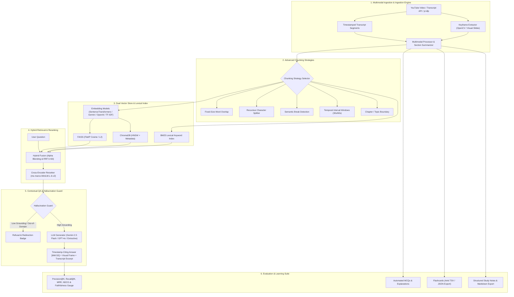

# 🎬 Multimodal YouTube RAG & Learning Studio

A state-of-the-art **Multimodal Video Retrieval-Augmented Generation (RAG)** and educational studio. Built from the ground up to analyze YouTube transcripts, audio, and visual keyframes, perform hybrid semantic-keyword retrieval with reranking, guard against hallucinations with timestamp-verified citations, systematically evaluate RAG performance, and automatically generate interactive quizzes, flashcards, and study notes.

---

## 🌟 Key Architecture & Features



---

## 🚀 Feature Breakdown

### 1. Multimodal Understanding
- **Multimodal Video Processing**: Ingests timestamped transcripts, audio segment metadata, and extracts video keyframes via OpenCV or high-contrast educational visual slide cards.
- **Visual Frame Grounding**: Associates every retrieved chunk with its corresponding visual keyframe and OCR text cues.
- **Section & Chapter Summaries**: Automatically detects YouTube chapters or clusters transcripts into logical sections with summaries, key takeaways, and timestamp links.

### 2. Advanced RAG
- **5 Chunking Strategies**:
  - `Fixed`: Word window with configurable token overlap.
  - `Recursive`: Hierarchical separators (`\n\n`, `\n`, `. `, ` `).
  - `Semantic`: Cosine similarity drop detection between adjacent sentences.
  - `Temporal`: Fixed time windows (e.g. 60s) preserving video playback context.
  - `Chapter`: Exact chapter/topic boundaries.
- **FAISS vs ChromaDB Benchmark**: Head-to-head empirical profiler measuring indexing throughput, query latency (mean & P95), and Top-K Jaccard consensus.
- **Hybrid Retrieval & Reranking**:
  - Dense Vector Search + BM25 Okapi Keyword Search.
  - Fusion via **Reciprocal Rank Fusion (RRF)** or **Weighted Alpha Blending** (`alpha * dense + (1 - alpha) * bm25`).
  - Cross-Encoder reranking (`ms-marco-MiniLM-L-6-v2`) filtering irrelevant passages before generation.

### 3. Contextual Question Answering
- **Exact Timestamp Citations**: Every generated fact cites exact video timecodes (`[MM:SS]`).
- **Interactive Timecode Jump Links**: One-click links jump directly to YouTube at that second (`&t=123s`).
- **Supporting Transcript & Frame Cards**: Displays exact context quotes, confidence scores, and visual keyframe cards.
- **Hallucination Guard**: Detects out-of-domain queries, calculates keyword overlap, and explicitly abstains from unanswerable questions to prevent hallucination.

### 4. Evaluation Framework
- **Information Retrieval Metrics**:
  - `HitRate@K`
  - `Precision@K`
  - `Recall@K`
  - `MRR` (Mean Reciprocal Rank)
  - `NDCG@K` (Normalized Discounted Cumulative Gain)
- **Answer Faithfulness**: Claim-by-claim verification identifying supported statements vs. hallucination risks.
- **Model Comparison Matrix**: Benchmarks multiple embedding models (SentenceTransformers, TF-IDF, Gemini) and LLMs.

### 5. Learning Features
- **Automated Quizzes**: Generates MCQs with 4 options, difficulty ratings, correct explanations, and jump links to where the concept is taught.
- **Active-Recall Flashcards**: Generates front/back concept cards exportable to **Anki TSV** and **JSON**.
- **Structured Study Notes**: Comprehensive lecture notes with Executive Summary, Chronological Topic Breakdown, Formulas & Code, Glossary, and Markdown export.

---

## 📦 Installation & Setup

1. **Clone or navigate to workspace**:
   ```bash
   cd /Users/samyuktamenon/.gemini/antigravity/scratch/multimodal-youtube-rag
   ```

2. **Install dependencies**:
   ```bash
   pip3 install -r requirements.txt
   ```

3. **(Optional) Configure API Keys**:
   Set `GEMINI_API_KEY` or `OPENAI_API_KEY` in your environment or via the Streamlit sidebar:
   ```bash
   export GEMINI_API_KEY="your-api-key"
   ```
   *(Note: The system includes a deterministic offline RAG mode, so an API key is not required to explore or test!)*

---

## 🏃‍♂️ Running the Application

Launch the Streamlit Studio:
```bash
streamlit run app.py
```

The interactive UI will open at `http://localhost:8501`.

---

## 🧪 Running the Unit Test Suite

Run the full automated test suite verifying all 5 core modules:
```bash
PYTHONPATH=. python3 -m unittest discover -s tests -p "test_*.py"
```
*(All 22 unit tests verify chunking, FAISS/ChromaDB storage, hybrid search, RRF, hallucination detection, retrieval metrics, faithfulness, quizzes, and flashcards!)*

