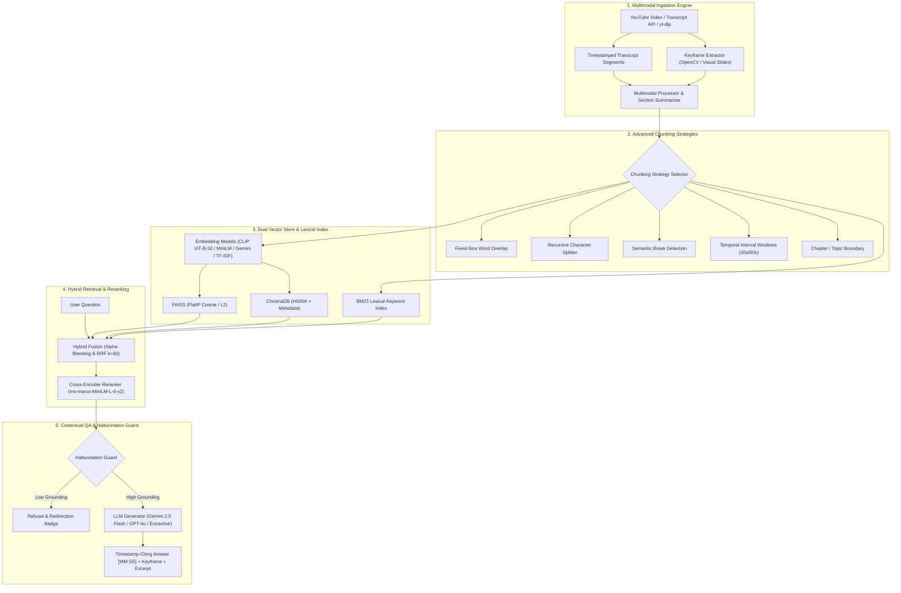

# 🎬 Multimodal YouTube RAG & Learning Studio

An empirical **Multimodal Video Retrieval-Augmented Generation (RAG)** and educational studio. Built from the ground up to analyze YouTube transcripts and video keyframes, project text and image keyframes into shared metric vector spaces (via **CLIP ViT** and **SentenceTransformers**), perform hybrid semantic-keyword retrieval with cross-encoder reranking, guard against hallucinations with timestamp-verified citations, systematically evaluate RAG performance, and automatically generate interactive quizzes, flashcards, and study notes.

---

## 🌟 Key Architecture & Features



---

## 📊 Empirical Chunking & Retrieval Benchmark

Evaluated on the curated benchmark dataset (`data/benchmark_dataset.json`) using hybrid retrieval (FAISS dense vectors + BM25 keyword search fused via Reciprocal Rank Fusion):

| Chunking Strategy | Chunks | Avg Words/Chunk | HitRate@1 | HitRate@3 | Recall@3 | Precision@3 | MRR | Query Latency |
| :--- | :--- | :--- | :--- | :--- | :--- | :--- | :--- | :--- |
| **Recursive Splitter** | 4 | 58 | **100.0%** | **100.0%** | **100.0%** | 66.7% | **1.000** | 11.3 ms |
| **Chapter Boundaries** | 6 | 49 | **100.0%** | **100.0%** | **100.0%** | 72.2% | **1.000** | 8.7 ms |
| **Semantic Boundary** | 4 | 46 | **100.0%** | **100.0%** | **100.0%** | 50.0% | **1.000** | 11.1 ms |
| **Temporal Intervals (60s)** | 9 | 42 | 83.3% | **100.0%** | **100.0%** | **77.8%** | 0.917 | **8.5 ms** |
| **Fixed Word Overlap** | 3 | 72 | 83.3% | **100.0%** | **100.0%** | 61.1% | 0.917 | 12.4 ms |

> **Key Takeaway:** **Recursive** and **Chapter-based** chunking achieved the highest retrieval rank fidelity (MRR = 1.000, HitRate@1 = 100%), while **Temporal Windowing** yielded the highest context density (Precision@3 = 77.8%) and lowest retrieval latency (8.5 ms).

---

## 🚀 Feature Breakdown

### 1. Multimodal Understanding & Embeddings
- **CLIP ViT Integration**: Supports `clip-ViT-B-32` to project both visual keyframe images and textual queries into a shared 512-dimensional vector space.
- **Visual Keyframe Grounding**: Extracts high-contrast keyframes via OpenCV, aligning timestamps with transcript intervals.
- **Section & Chapter Summaries**: Detects YouTube chapters or clusters transcripts into structured sections with timecode jump links.

### 2. Advanced Retrieval Engine
- **5 Chunking Strategies**: Fixed-size overlap, recursive character splitting, semantic break detection, temporal windowing, and chapter boundary chunking.
- **Dual Vector Store**: Head-to-head comparison between **FAISS** (FlatIP cosine) and **ChromaDB** (HNSW persistent storage).
- **Hybrid Retrieval & Reranking**: Dense vector search + BM25 Okapi fused via **Reciprocal Rank Fusion (RRF $k=60$)** or weighted alpha blending, followed by Cross-Encoder reranking (`ms-marco-MiniLM-L-6-v2`).

### 3. Contextual QA & Hallucination Guard
- **Exact Timestamp Citations**: Answers cite exact video timecodes (`[MM:SS]`) with jump links.
- **Hallucination Guard**: Calculates keyword overlap and semantic support, actively abstaining from ungrounded queries.

### 4. Interactive Learning Suite
- **Automated Quizzes**: Generates MCQs with explanations linked to video timestamps.
- **Active-Recall Flashcards**: Concept cards exportable to **Anki TSV** and **JSON**.
- **Structured Study Notes**: Chronological lecture notes with Markdown export.

---

## 📦 Installation & Quickstart

### 1. Install Dependencies
```bash
pip install -r requirements.txt
```

### 2. Run the Automated Unit Test Suite (22 Tests)
```bash
PYTHONPATH=. python3 -m unittest discover -s tests -p "test_*.py"
```

### 3. Run Empirical Chunking Benchmark
```bash
python core/evaluation/run_chunking_benchmark.py
```

### 4. Launch Interactive Streamlit Studio
```bash
streamlit run app.py
```

---

## 📄 License
MIT License
